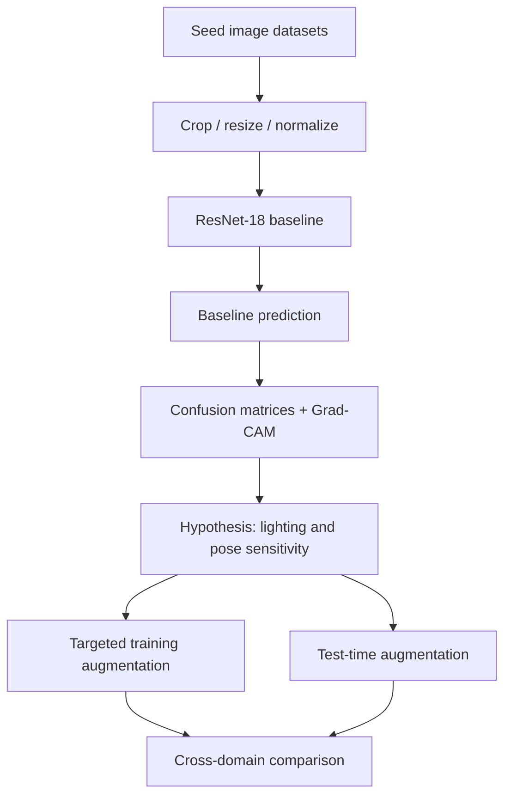

# Robust Oil Palm Seed Quality Classification Under Distribution Shift

**Computer Vision · PyTorch · Transfer Learning · ResNet-18 · Grad-CAM · Test-Time Augmentation**

A university computer vision project investigating how well a binary image classifier distinguishes **good and bad germinated oil palm seeds**, especially when photographs differ from the training distribution in lighting and pose.

The central question is not simply whether a model can classify familiar training-style images; it is **how performance changes under realistic distribution shift** and which interventions are empirically useful.

## Problem and approach

1. Fine-tune an **ImageNet-pretrained ResNet-18** for two classes: `GoodSeed` and `BadSeed`.
2. Evaluate the baseline on a training-style image collection and on two independent shifted collections.
3. Analyse systematic errors using confusion matrices, representative mistakes and **Grad-CAM**.
4. Test a hypothesis-driven training-time augmentation strategy for lighting and pose variation.
5. Evaluate **test-time augmentation (TTA)** separately and compare configurations.



## Data and evaluation design

| Set | Samples | Role |
| --- | ---: | --- |
| Batch 1 — pre-cropped images | 1,752 | Training / validation source (80/20 stratified split) |
| Batch 2 — different room lighting | 900 | Lighting-shift evaluation |
| Batch 3 — light-box / pose-shift images | 1,198 | Pose-shift evaluation |

Batch 2 and Batch 3 seed crops are reconstructed from labelled bounding boxes on full-tray photographs. The notebook uses PIL, OpenCV and custom PyTorch Dataset classes for image loading.

## Results reported in the notebook

| Configuration | Batch 2: lighting shift | Batch 3: pose shift |
| --- | ---: | ---: |
| Baseline ResNet-18 | 87.11% | 83.64% |
| Baseline + TTA | **88.11%** | **84.97%** |
| Targeted training augmentation | 86.78% | 82.47% |
| Targeted training augmentation + TTA | 88.00% | 82.55% |

**Interpretation:** Baseline + TTA performed best on both shifted sets in the reported comparison. The more heavily augmented training configuration did **not** yield a consistent improvement; this is an important negative result, not something to hide.

The notebook also reports **99.77% accuracy on the full Batch-1 evaluation**. Because this evaluation includes samples used for training as well as validation, this figure is **not** an independent held-out test accuracy and should not be marketed as such. The independent shift evaluations above are more informative for the project's robustness question.

## Error analysis

- **Lighting shift:** Changes in color, reflections and shadows can change the appearance of visual seed-quality cues.
- **Pose shift:** Different orientations and crop compositions can disrupt learned spatial patterns.
- **Grad-CAM:** Visual explanations help inspect whether the model attends to relevant seed regions or background artefacts.
- **Confusion matrices:** The notebook investigates false-good and false-bad classifications and how these vary across domains.

## Tech stack

Python, PyTorch, Torchvision, OpenCV, PIL, NumPy, Pandas, Matplotlib, scikit-learn, and `pytorch-grad-cam`.

## Reproduce the experiment

1. Add the original **executable Jupyter/Colab notebook (`.ipynb`)** to this repository. A PDF export alone is not sufficient for reproducibility.
2. Install the dependencies required by the notebook:

   ```bash
   pip install torch torchvision numpy pandas matplotlib seaborn pillow opencv-python scikit-learn torchinfo grad-cam
   ```

3. Arrange the seed images and CSV annotations as described in the notebook. **Check dataset licensing and permissions before publishing images.**
4. Update the notebook's `BASE_PATH` (originally an environment-specific Colab path) to match the available data location.
5. Run training and evaluation cells in sequence, recording hardware, library versions and random seed if exact reproducibility is important.

### Add visuals

Place **original, permission-cleared** visuals under `assets/`:

- An example of one seed under normal and shifted lighting (if sharing is allowed).
- A comparison table or bar chart of accuracy across test sets.
- A Grad-CAM example showing model attention.
- Confusion matrices and examples of hard negatives.

## Limitations and next steps

Training is based on a relatively small and limited source domain, and crop artifacts can differ across batches. Random augmentations do not perfectly reproduce structured lighting changes or real camera/pose changes. Further experiments could consider domain adaptation, targeted sampling or alternative normalization schemes.

**Status:** Academic experiment; not a deployed quality-control system. Numbers above are reproduced from the supplied notebook report, not independently rerun here.

## Attribution

Developed for **COMP3029 Computer Vision**, University of Nottingham Malaysia. Add the dataset owner/source and any teammates or supervisors if relevant; do not upload restricted data or claim group work as solo work.
